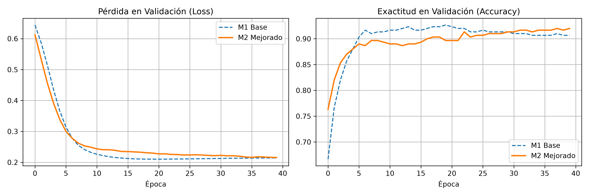

Asesor Financiero Inteligente para PyMEs

Sistema neuro-agéntico para evaluación de microcréditos para py ME. Se trata de un sistema que combina un modelo de redes neuronales para predecir riesgo y un agente de lenguaje para interactuar con el usuario.
Los componentes que lo integran son:

1. Red Neuronal (Keras / TensorFlow): modelo que permite estimar la probabilidad de riesgo alto de una solicitud de crédito
2. Agente de lenguaje (LangGraph + Gemini): permite interactuar con el usuario en lenguaje natural. Además decide cuándo debe utilizar el modelo de redes neuronales (punto 1) o realizar el cálculo de la cuota y capacidad de pago.

El sistema se presenta a través de una aplicación de chat (Streamlit).
---

Contenido

Qué hace el proyecto
Arquitectura
Estructura del repositorio
Instalación y ejecución
El modelo de Deep Learning (Unidad 4)
El agente (Unidad 5)
Ejemplo de uso
Limitaciones conocidas
Tecnologías

Qué hace el proyecto

El usuario introduce en el chat la información de la PyME que solicita el microcrédito. El agente:

Responde preguntas generales sobre microcréditos (sin utilizar herramientas)
Evalúa si la solicitud es de riesgo (utilizando la red neuronal). Para ello requiere de los datos financieros de la empresa (cuando los introduce el usuario)
Simula la capacidad de pago (calcula la cuota mensual y la compara con el margen disponible)
Solo pregunta por aquellos datos que no ha introducido el usuario (no los inventa). Esto se especifica en el system prompt (src/agente.py)
Almacena la conversación en el contexto de la sesión (browser session) mediante un thread_id único por sesión.

Variables que utiliza la red neuronal en cada solicitud:

Variable Descripción
ingresos_mensuales Ingresos mensuales promedio de la PyME
monto_solicitado Monto del crédito solicitado
plazo_meses Plazo de pago (meses)
antiguedad_anos Años de operación de la empresa
ratio_endeudamiento Ratio de endeudamiento (proporción de ingresos comprometidos) [0.0, 1.0]
score_credito Score de crédito [300, 850]
---

Arquitectura
```

Usuario ──► app.py (Streamlit)
│
▼
src/agente.py  ── agente ReAct (LangGraph) + Gemini
│            memoria: MemorySaver por thread_id
│            respaldo: segundo modelo si hay 503/429/timeout
▼
src/tools.py ─┬─► evaluar_riesgo_neuronal_tool ─► src/inferencia.py
│                                        │
│                          models/modelo_microcredito.keras
│                          models/scaler_microcredito.pkl
│
└─► calcular_capacidad_pago_tool  (cálculo de cuota)
```

Herramientas del agente

evaluar_riesgo_neuronal_tool (src/tools.py → src/inferencia.py)
Realiza una transformación de las 6 variables de entrada con el StandardScaler usado en el entrenamiento (guardado). Posteriormente pasa dichas variables por la red. La salida de la red es la probabilidad de riesgo alto. Si es mayor de 0.5 se considera Riesgo Alto (Rechazado), en otro caso Riesgo Bajo (Aprobado). Devuelve además el nivel de confianza y una recomendación preliminar.

calcular_capacidad_pago_tool (src/tools.py)
Usa la fórmula de amortización de cuota fija. La tasa es de 1.8% mensual:
```

cuota = monto · i · (1 + i)^n / ((1 + i)^n − 1)
```

Posteriormente calcula los ingresos libres (ingresos(1 - ratio_endeudamiento)). El máximo soportable es 40% de los ingresos libres. Si la cuota es menor o igual a este valor se considera suficiente capacidad de pago.

Manejo de fallos del LLM

En ejecutar_agente se intenta primero con el modelo principal (se realizan 2 intentos con un breve tiempo de espera). En caso de error temporal (503, 429, RESOURCE_EXHAUSTED, timeout....) se vuelve a ejecutar en el mismo hilo pero utilizando el modelo de respaldo. De esta forma comparten el mismo MemorySaver y la conversación sigue sin repetirse el último mensaje del usuario.
---

Estructura del repositorio
```

Asesor-Financiero-Inteligente-para-PyMEs/
├── app.py                           Interfaz de chat (Streamlit)
├── requirements.txt                 Dependencias
├── .env.example                     Plantilla de variables de entorno
├── .gitignore
├── assets/
│   └── curvas_entrenamiento_u4.png  Curvas de validación de los dos modelos
├── models/
│   ├── modelo_microcredito.keras    Red neuronal entrenada (Modelo Mejorado)
│   └── scaler_microcredito.pkl      StandardScaler ajustado con el set de entrenamiento
├── notebooks/
│   ├── entrenamiento_u4.ipynb       Generación de datos, entrenamiento y evaluación
│   └── evaluacion_agente_u5.ipynb   Casos de prueba de trayectoria del agente
└── src/
├── agente.py                    Agente LangGraph, system prompt, reintentos y respaldo
├── inferencia.py                Carga del modelo y predicción de riesgo
└── tools.py                     Herramientas expuestas al agente
```
---

Instalación y ejecución

Requisitos

Python 3.10 o superior
Una API key de Google AI Studio (Gemini)

Pasos

```bash
1. Clonar el repositorio
git clone https://github.com/FrancyDaniela/Asesor-Financiero-Inteligente-para-PyMEs.git
cd Asesor-Financiero-Inteligente-para-PyMEs

2. Crear y activar un entorno virtual
python -m venv venv
source venv/bin/activate        # Linux / macOS
venv\Scripts\activate           # Windows

3. Instalar dependencias
pip install -r requirements.txt

4. Configurar variables de entorno
cp .env.example .env            # en Windows: copy .env.example .env
Editar .env y poner la clave real en GOOGLE_API_KEY

5. Ejecutar la aplicación
streamlit run app.py
```

Variables de entorno

Variable Obligatorio Uso
GOOGLE_API_KEY Si Clave de Google AI Studio. Si no se proporciona se genera un error en src/agente.py (al importarlo)
GEMINI_MODEL No Modelo principal de Gemini. En caso de no indicarse se usa el default de src/agente.py
GEMINI_MODEL_RESPALDO No Modelo de respaldo en caso de error temporal.

El fichero .env real está en el .gitignore (no subirlo al repositorio).

Cuando se modifica el src/agete.py hay que reiniciar streamlit run app.py. Anteriormente se cargaba el módulo en cada mensaje (por lo que se reseteaba la memoria y el agente olvidaba la conversación).

Reentrenar el modelo

Desde el directorio notebooks/ abrir el notebook notebooks/entrenamiento_u4.ipynb. Las rutas en los save son relativas (../models y ../assets). Ejecutar las celdas en orden. Se regenerará el modelo (y escalador y gráfica).
---

El modelo de Deep Learning (Unidad 4)

Todo lo siguiente corresponde al contenido del notebook notebooks/entrenamiento_u4.ipynb.

Datos

Se genera un dataset sintético (con np.random.seed(42)) de 2000 solicitudes. Las variables de entrada son las 6 mencionadas. La etiqueta riesgo_alto se genera con una determinada fórmula (que combina monto/ingresos, endeudamiento, antigüedad y score de crédito) y con algo de ruido (normal). Se considera riesgo alto si el puntaje es > 0.5.

Porcentajes de clase obtenidos: 63.3% riesgo alto y 36.7% riesgo bajo.

Partición y escalado

Se realiza una división estratificada (70% entrenamiento, 15% validación y 15% prueba (300 registros)). El StandardScaler se ajusta sólo en el conjunto de entrenamiento. Se guarda en models/scaler_microcredito.pkl.

Dos arquitecturas (para comparar)

Se entrenan ambos modelos durante 40 epochs. Optimizador Adam. Función de pérdida binary_crossentropy. Tamaño de batch 32.

Modelo 1 (Base)Modelo 2 (Mejorado)
CapasDense(16, ReLU) → Dense(8, ReLU) → Dense(1, sigmoid)Dense(32, ReLU) → BatchNormalization → Dropout(0.3) → Dense(16, ReLU) → Dropout(0.2) → Dense(1, sigmoid)
RegularizaciónNingunaDropout y BatchNormalization

El modelo 2 es el que se guarda en models/modelo_microcredito.keras (el que utiliza el agente).

Curvas de validación



Se observa que ambas curvas de validación caen rápidamente en las primeras épocas. Al final quedan muy similares (aprox 0.2). En cuanto a la exactitud también quedan similares (~0.90 - 0.92). El modelo 1 alcanza más rápido dicho nivel. El modelo 2 crece de manera más gradual.

Evidencia de fallos en el conjunto de prueba

En el notebook se imprimen los errores cometidos por el modelo 2 en el conjunto de prueba. Hay 33 de 300 que están mal predichos. Por ejemplo, en uno de ellos (realmente riesgo alto (valor_real=1)) el modelo predice riesgo bajo (con probabilidad de riesgo 0.31). Los datos son ingresos≈18 198, monto≈17 555, plazo=48 meses, antigüedad=2.8 años, ratio_endeudamiento=0.18, score_credito=825.
---

El agente (Unidad 5)

En el notebook notebooks/evaluacion_agente_u5.ipynb se definen 3 casos para analizar el comportamiento del agente. Todos ellos sobre el mismo thread_id.

Caso Mensaje Herramienta esperada
1. Saludo / consulta general Pregunta por los requisitos para solicitar un microcrédito Ninguna
2. Evaluación de riesgo PyME con ingresos de $15,000, solicita $8,000 a 18 meses. 3.5 años de antigüedad. Ratio de endeudamiento 0.35. Score 720. evaluar_riesgo_neuronal_tool
3. Capacidad de pago Pregunta de seguimiento sobre la cuota mensual de 8k a 18 meses con ingresos 15k calcular_capacidad_pago_tool

En el notebook entregado se muestra la salida en cada caso. En todos aparece el error "API key not valid" de la API de Gemini. Es decir, el notebook se ha ejecutado con una clave inválida. Por ello no hay respuestas del agente. En este README no mostramos resultados del agente.
---

Ejemplo de uso

Mensaje de entrada (caso 2 del notebook):

Por favor evalúa esta PyME: Ingresos de $15,000, solicita $8,000 a 18 meses, tiene 3.5 años de antigüedad, ratio de endeudamiento del 0.35 y score de crédito de 720.

El diseño del agente es invocar a la herramienta evaluar_riesgo_neuronal_tool pasándole los 6 datos. El resultado es un JSON con diagnostico, probabilidad_riesgo_alto, nivel_confianza y recomendacion_preliminar. Éste es explicado al usuario. Posteriormente, si el usuario pregunta sobre la cuota se invoca a calcular_capacidad_pago_tool. Devuelve cuota_mensual_estimada, ingresos_libres_disponibles, cuota_maxima_soportable y capacidad_pago_suficiente.
---

Limitaciones conocidas

Los datos son sintéticos. El modelo se ha entrenado con datos generados por código (no históricos de crédito). La etiqueta de riesgo se obtiene de una fórmula (definida en el notebook). Por ello las métricas reflejan el grado de reproducción de la regla por parte de la red, pero no su rendimiento en un entorno financiero real.
No hay evaluación del agente. En el notebook de la Unidad 5 se muestran errores de autenticación (ver apartado anterior)
La tasa (1.8%) y el tope (40% ingresos libres) están duros en src/tools.py
Dependencia de la API de Gemini. Es necesario disponer de conexión y clave válida. Los modelos de google se retiran con el tiempo. Por ello es posible modificar el nombre de modelo en .env
Memoria en RAM. El MemorySaver sólo almacena mientras está activo el proceso de streamlit
Es una herramienta de apoyo. No implica una decisión de aprobación o rechazo real de crédito. Es una evaluación preliminar para apoyo al análisis.
---

Tecnologías

Deep Learning: TensorFlow / Keras. scikit-learn. pandas. numpy. joblib.
Agente: LangChain. LangGraph (create_react_agent, MemorySaver). langchain-google-genai (Gemini).
Interfaz: Streamlit.
Visualización y análisis: matplotlib, seaborn, Jupyter.
Configuración: python-dotenv.


VIDEO DE EXPLICACION DE LA INTELIGENCIA ARTIFICIAL: https://drive.google.com/file/d/1fckobqUkd56f5MH0PRrCEjvmk222looW/view?usp=sharing 

